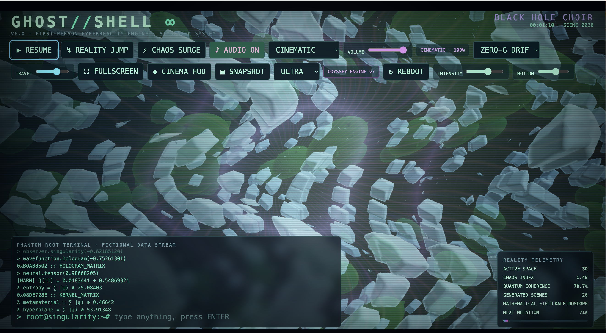
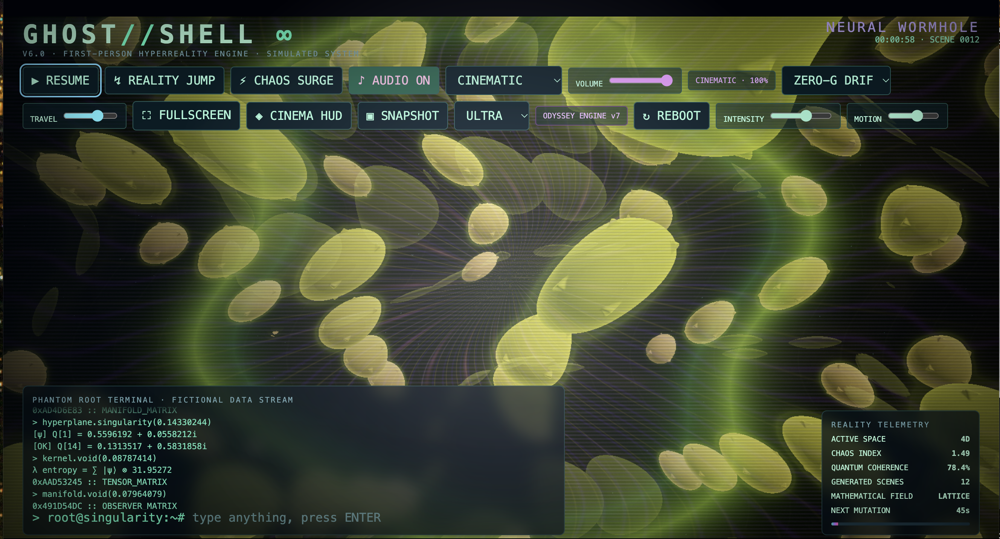
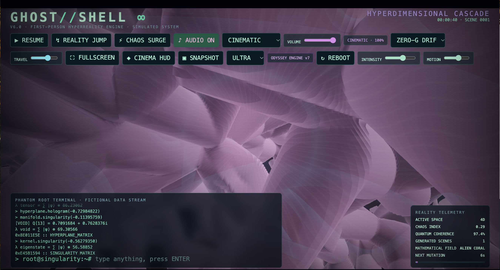

<div align="center">

# GHOST//SHELL ∞

### QUANTUM ODYSSEY

**Step inside the machine. Lose yourself in impossible dimensions.**

[](https://developer.mozilla.org/en-US/docs/Web/JavaScript)
[](https://developer.mozilla.org/en-US/docs/Web/API/WebGL2RenderingContext)
[](https://developer.mozilla.org/en-US/docs/Web/API/Web_Audio_API)
[](LICENSE)

[](https://osgk.com/ghost/)

### [▶ LAUNCH THE LIVE EXPERIENCE →](https://osgk.com/ghost/)

*An endless, immersive, browser-based science-fiction art experiment.*



</div>

## What is GHOST//SHELL?

What if a Hollywood hacker terminal opened a portal into an impossible mathematical universe?

**GHOST//SHELL** is an interactive audiovisual experience that combines a fictional command console, first-person camera movement, GPU-rendered procedural environments, quantum-inspired imagery, and an evolving electronic soundtrack. Its autonomous director keeps generating new scenes while you travel through the machine, change realities, or deliberately unleash chaos.

> **Creative simulation, not a hacking tool or a quantum computer.** Terminal commands, quantum telemetry, and system events are fictional. The geometry and shader effects are mathematical visual art, not measured physical quantum states.

## Explore the multiverse

### Neural Wormhole



### Hyperdimensional Cascade



*Screenshots captured from the live experience. Every procedural session can look different.*

## Features

- **A world you move through:** first-person flight, zero-G drift, and orbital camera styles.
- **Generative environments:** fractal-inspired structures, wormholes, crystalline fields, tunnels, dimensional folds, and surreal geometry.
- **Autonomous scene direction:** evolving colors, shapes, movement, transitions, and visual intensity.
- **Spatially animated sound:** synthesized drones, pulses, music-like textures, and event-driven stereo effects. Headphones recommended.
- **Cinematic hacker console:** endlessly generated fictional command output and keyboard interaction.
- **Reality Jump & Chaos Surge:** immediately reshape the experience or spike its intensity.
- **Cinema HUD & Snapshot:** hide the interface or capture an image of an unexpected world.
- **Performance controls:** tune graphics quality, intensity, motion, travel speed, and volume.
- **Static and self-contained:** no account, backend, or API key required.

## Get inside

**Play online:** **https://osgk.com/ghost/**

**Run locally:**

1. Download or clone this repository.
2. Open `index.html` in a recent WebGL2-capable desktop browser (Chrome recommended).
3. Enable **Audio** to start the soundtrack. Browsers require a user gesture before playing sound.
4. Try **Fullscreen**, select your camera mode, and let the world evolve.

The app is a static HTML/CSS/JavaScript project. No build step or package installation is required.

## Controls

| Control | Action |
| :-- | :-- |
| **Reality Jump** / `R` | Enter a new procedural environment |
| **Chaos Surge** / `Space` | Trigger a dramatic visual and audio event |
| **Camera mode** / `M` | Cycle first-person movement styles |
| **Fullscreen** / `F` | Toggle fullscreen |
| **Cinema HUD** / `H` | Hide or show the interface |
| **Snapshot** / `P` | Capture a PNG image |
| **Audio / Volume / Sound mode** | Configure the soundtrack |
| **Travel / Motion / Intensity** | Adjust movement and visual energy |
| **Graphics preset** | Balance visual quality against GPU load |
| **Reboot** | Restart the experience |

Keyboard shortcuts may not trigger while the terminal input field has focus.

## Built with

| Component | Technology |
| :-- | :-- |
| Interface | HTML5, CSS, vanilla JavaScript |
| Graphics | WebGL2, GLSL shaders, procedural rendering |
| Sound design | Web Audio API and stereo-positioned synthesized effects |
| Scene generation | Client-side procedural parameters and transitions |
| Deployment | Static hosting |

## Project files

```text
ghost/
├── index.html
├── README.md
├── LICENSE
├── NOTICE
└── assets/
    ├── ghost-cinematic.png
    ├── ghost-hyperdimensional.png
    └── ghost-overview.png
```

## The idea

**Start with the familiar. End somewhere impossible.**

The entry point is a movie-style hacking console. Gradually, the familiar interface gives way to recursive architecture, quantum-inspired fields, synthetic soundscapes, and impossible perspectives. GHOST//SHELL is designed to feel less like using a computer and more like *being inside one*.

## Performance and accessibility

Visual complexity and performance depend on your browser and GPU. If animation stutters, lower the graphics preset, motion, or intensity. The experience includes rapid movement, flashing effects, and synthesized sound: pause, mute, or exit if uncomfortable.

## Creator

Created by **[OSGK](https://osgk.com/)**. The [live experience](https://osgk.com/ghost/) is the official project demo.

## License

Licensed under the **[Apache License, Version 2.0](LICENSE)**. See [`NOTICE`](NOTICE) for project attribution.

Commercial use, redistribution, and modification are permitted under the license's terms. Applicable copyright, license, and NOTICE attributions must be preserved as required by Apache 2.0. The license does **not** require prominent on-screen credit in derivative applications.
